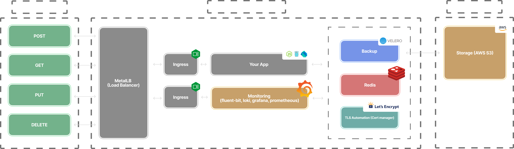

# Kit Architecture

This project organizes Kubernetes configurations and related files in a structured manner to promote clarity and maintainability. The primary goal is to group configurations by the concern they address, making the system easier to understand and manage.



## Core Concepts

### Folder Structure

At the root of the repository, you'll find directories dedicated to the different parts of the Kubernetes setup. This includes automation scripts, configurations for cluster-wide services, and setups for individual applications.

This project is organized for simplicity. Everything related to monitoring lives in the `monitoring` directory, everything related to Redis lives in the `redis` directory, and so forth.

```text
├── .github/
│   └── workflows/
│       ├── deploy-monitoring.yml
│       ├── deploy-redis.yml
│       ├── deploy-velero.yml
│       ├── k8s-cleanup.yml
│       └── velero-operations.yml
├── cert-manager-config/
│   └── values.yaml
├── cert-manager-custom-config/
│   ├── templates
│   ├── Chart.yaml
│   └── values.yaml
├── metallb-config/
│   ├── templates/
│   │   ├── metallb-address-pool.yaml
│   │   └── metallb-l2-advertisement.yaml
│   ├── Chart.yaml
│   └── values.yaml
├── monitoring/
│   ├── templates/
│   │   └── ingress.yaml
│   ├── Chart.yaml
│   ├── fluent-bit-values.yaml
│   ├── values-kube-prometheus.yaml
│   ├── values-loki.yaml
│   └── values.yaml
├── nginx-config/
│   └── values.yaml
├── redis/
│   └── values.yaml
└── velero/
    └── values.yaml
```

## What's Included

### Automations

The `.github` directory contains workflow files for GitHub Actions. These workflows automate CI/CD pipelines, such as deploying services to the Kubernetes cluster, running cleanup tasks, and other operational automation.

### Certificate Management

Certificate management configurations are split into two parts. `cert-manager-config` typically holds the base Helm chart values for deploying `cert-manager` itself, while `cert-manager-custom-config` contains specific custom resources, most notably `ClusterIssuer` definitions for production and staging environments using Let's Encrypt.

### Load Balancing

Infrastructure-level services essential for the cluster's operation have their dedicated directories. `metallb-config` houses the configuration for MetalLB, which provides load balancing services for bare-metal Kubernetes clusters. `nginx-config` contains the values for customizing the Nginx Ingress Controller.

### Monitoring, Caching, and Backups

Core shared services like `monitoring` (for Prometheus, Grafana, Loki, etc.), `redis` (for caching), and `velero` (for backups and disaster recovery) each have their own configuration directories.

## Package Management (Helm)

Most of the service-specific directories are structured as Helm charts. Helm is a package manager for Kubernetes that simplifies the deployment and management of applications. A typical Helm chart will have the following structure:

```text
└── my-custom-app/
    ├── Chart.yaml
    ├── values.yaml
    └── templates//
        ├── deployment.yaml
        ├── service.yaml
        ├── ingress.yaml
        ├── hpa.yaml
        ├── rbac.yaml
        ├── resourcequota.yaml
        └── ...
```

The `Chart.yaml` file contains metadata about the chart, such as its name, version, and any dependencies on other charts.

The `values.yaml` file provides default configuration values for the chart. Some of these have been pre-filled with values for Kubernetes Kit. For more complex charts like `monitoring`, you might also see more specific value files like `values-loki.yaml` or `values-kube-prometheus.yaml` to further organize settings.

The `templates/` directory contains Kubernetes manifest files written in a templating language (Go templates). When Helm deploys the chart, it processes these templates, injecting values from the `values.yaml` file (and any user-supplied overrides) to generate the final Kubernetes manifests that are applied to the cluster.

## Why this structure?

This Helm-centric and modular approach ensures that configurations are templatized, versionable, and repeatable. It makes deployments more reliable and simplifies the management of complex applications across different environments, all while being friendly to automation pipelines like those defined in the `.github` directory.
