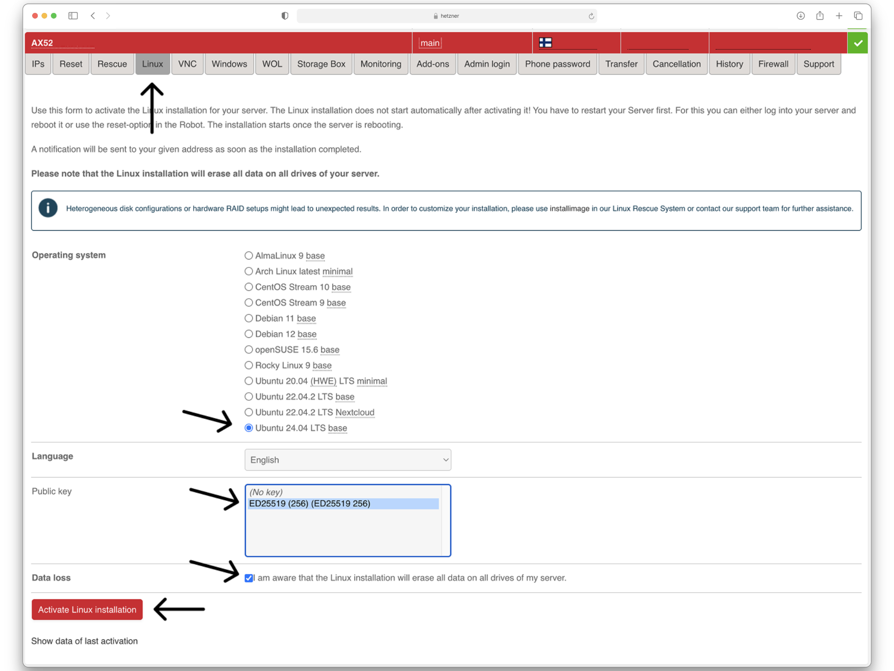

# Guided Tour Cloud

Kubernetes is meant to be used in the cloud (on a server). After all, it is a backend infrastructure, and backends need to be hosted somewhere. For this guide, we will be using a server from [Hetzner](https://www.hetzner.com/dedicated-rootserver/).

This guided tour is a walkthrough of setting up Kubernetes Kit on a server. Let's get started.

## Configure a Server

Find a server that fits your needs. The guide will follow renting a dedicated server [Hetzner](https://www.hetzner.com/dedicated-rootserver/).

When you make the purchase, you will need to select either a password for SSH or a public key. This guide uses a public key, which is more secure.

### Generate and print key

Run the following command to generate a new SSH key on your local machine. You will be asked to enter a passphrase, which is like a password, so don't forget it.

```sh
ssh-keygen -t ed25519 -C "hetzner" -f ~/.ssh/id_hetzner
cat ~/.ssh/id_hetzner.pub
```

Use this public key in the renting process.

> Recommendation: Store your keys in a password manager.

### Configure SSH

To connect to your server, we will use SSH. To this, you can use the following command.

```sh
ssh -i ~/.ssh/id_hetzner root@your.server.ip.address
```

However, typing this every time is not very convenient. We can instead update the `~/.ssh/config` file with the following.

> Find your IP address for the machine in Hetzner.

```txt
Host hetzner
    HostName your.server.ip.address
    User root
    IdentityFile ~/.ssh/id_hetzner
```

Now you can connect to your server by running:

```sh
ssh hetzner
```

### Install Linux

In order for any of this to work, our server needs an operating system. The most common one is Linux. Navigate to your server in Hetzner and follow the image.



Now you should be able to SSH into your server by running `ssh hetzner`.

## Kubernetes setup

Install the Hungrimind CLI globally from GitHub (no account needed). It is used to pull down the latest version of Kubernetes Kit.

```bash
sudo apt update
sudo apt install nodejs
sudo apt install npm
npm install -g github:hungrimind/hungrimind-cli
```

### Create a New Kubernetes setup

Generate your Kubernetes setup that uses the boilerplate with the CLI:

```bash
hungrimind kubernetes create my_infrastructure
```

Replace `my_infrastructure` with your desired project name.

### Answer the prompts

Kubernetes works with configuration files. These need to have the correct values for it to work. Within the Kubernetes Kit, each value contains a comment about how it's used.

Once this is done, you will have successfully cloned the project to your local machine. The next step is to deploy the preconfigured apps to the cluster, which is done by running the `first_install.sh` script. You can do this within the setup flow or do it later.

> ✅ You should now have a cluster running!
> Run `kubectl get pods --all-namespaces` to see the running app.

## Deploy an App

First, navigate into your infrastructure folder, then run the following command to create an app: `hungrimind kubernetes add app`. You need to set the domain name to the domain of your server.

> You can use `machine-info` for app name and `hungrimind` as the Docker username; this is a public image we created for you to test with.

```sh
hungrimind kubernetes add app
? App name: machine-info
? App description: machine info
? Production domain (e.g., server.hungrimind.com): server.your-domain-name.com
? Development domain (e.g., server-dev.hungrimind.com): server-dev.your-domain-name.com
? Docker username: hungrimind
```

Now you should be able to see a folder based on the name you provided. The next step is to deploy it to our cluster.

> [!WARNING]
> **Before Interacting with the Cluster**
>
> To ensure your shell session can communicate with the cluster, you must set the `KUBECONFIG` environment variable. This is necessary **every time you start a new SSH session** or open a new terminal window on the server.
>
> While the installation script initially sets this variable for the environment it runs in, subsequent sessions require you to execute the following command:
>
> `export KUBECONFIG=/etc/rancher/k3s/k3s.yaml`

```sh
cd machine-info
helm upgrade --install machine-info . --namespace machine-info --create-namespace --values ./values.yaml --debug --wait
```

Now you should see your app running when you do:

```sh
kubectl get pods -n machine-info
```

You should be able to access it through the domain we entered in the setup: `http://server.your-domain-name.com/version`.

## Next Steps

Ready to deploy your own application? Check out our guide on [Add a New App](../guides/add-an-app.md) to learn how to deploy custom applications to your cluster.
