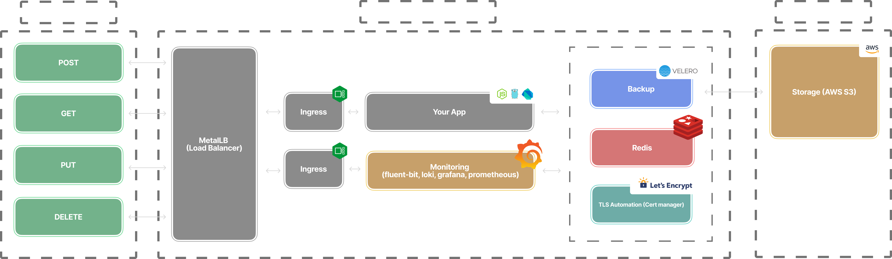
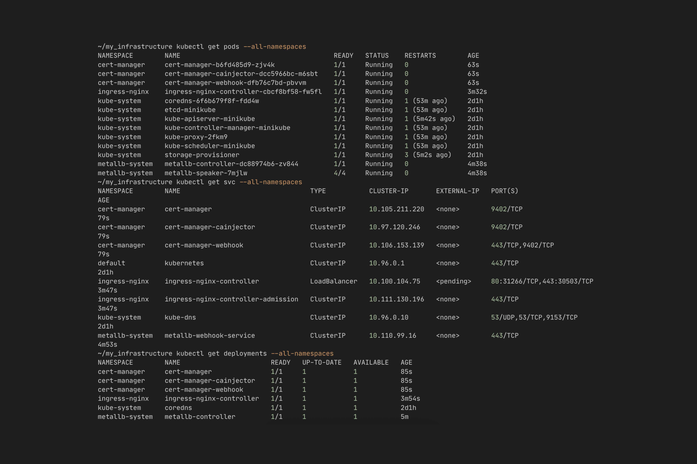

# Introduction

This Kubernetes Kit is a template of the infrastructure we use in our projects, based on [k3s](https://k3s.io/). If you are new, it is a good starting point to set up your first Kubernetes cluster. If you are experienced, it will speed up your development process.

This infrastructure setup is based on our real-world experience running the Hungrimind platform.

## What's Included in this Kit?

- **CLI:** [hungrimind-cli](https://github.com/hungrimind/hungrimind-cli) creates a new project from this kit.
- **Documentation:** the guides in this folder.

## What is Kubernetes?

First, we need to take a step back and understand what a backend is. A backend is code for your app (or website or anything) that is handled in a separate place from that app.

This is usually run on a server (a computer in a different location) that is connected to the internet.

As your application grows in complexity and popularity, you will need to scale your backend. This means more servers, more security, more monitoring, more logging, more everything.

This is called Backend Infrastructure.

Kubernetes is a tool that helps you manage your backend infrastructure.

## Why use Kubernetes?

### For Novel Experiences

Depending on the apps you are building, you might not need Kubernetes. For example, a todo app or a notes app might not need a Kubernetes backend. If the core of your application is a CRUD app (Create, Read, Update, Delete from a database), you don't need Kubernetes.

> [!NOTE]
> **Note**
>
> You definitely _can_ still use Kubernetes for simple applications. Depends on your goals.

You can use services like Firebase, Supabase, or AWS to store your data. Services like Vercel or Appwrite to host your frontend. And you can build really cool applications without Kubernetes.

But when you start building more novel experiences, your backend will get more complex. This doesn't always mean you need Kubernetes, but oftentimes it is a good option. Especially if you want to bring down costs and learn more about infrastructure.

### Our Kubernetes Journey

For us, this started when we wanted to build an interactive IDE in the browser for our Flutter Course. In order to do this, we need a Flutter app running on a server that each user can connect to.

TLDR: This doesn't work if you are using serverless providers, and for regular hosted providers, it would be very expensive ($1000/month vs $50-$100/month for a Kubernetes cluster).

So to make an in-browser IDE, the potential cost and our drive to learn made us choose Kubernetes (k3s).

### Overengineering For Fun

Since then, we have learned a lot about Kubernetes and have moved other services to our Kubernetes Cluster that don't necessarily need to be there, but it's fun, and it's free since we already have a server.

> [!NOTE]
> **Note**
>
> It's not actually free, but since we already pay for a server, any additional services we host on it don't cost us anything extra.

Instead of Vercel, we host some of our websites in the cluster; it's not a 1-click deploy, but it's awfully close.

It's opened up a lot of opportunities to save money and learn about how backend infrastructure works. And since it saves so much money, it's also opened up a lot of possibilities that we would not have thought about otherwise.

## Guiding Principles

### Minimal YAML & Sensible Defaults

Every piece of configuration adds complexity. We believe in providing essential building blocks and sensible defaults, not depending on overly complex Helm charts or custom operators (as much as it makes sense). We primarily use standard Kubernetes resources.

### Kubernetes Best Practices

There are many ways to configure Kubernetes. They can all work, but the more time you spend choosing and deliberating, the less time you spend building products. We incorporate battle-tested Kubernetes best practices for security, scalability, observability, and resilience.

### Own Your Configuration

This could have been a package or a complex operator, but we believe in owning your configuration. All these features are code that you can see, explore, and update for your use cases. (Let us know about your updates so we can potentially improve the kit.)

## Learn more

- [Start with a Guided Tour locally using minikube](guided-tour-local.md)
