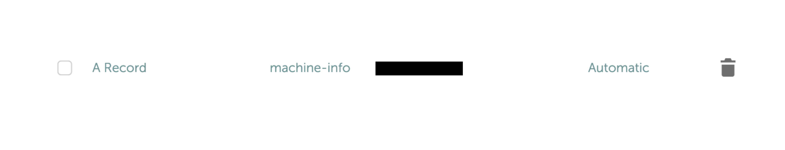

# Add a New App

The Kubernetes Kit goes through the process of deploying the preconfigured apps we have defined. But you can (and should) deploy your own apps. This guide will walk you through the process of deploying a Go app from scratch.

We are going to build "machine-info" which you have used through the guided tour. We use this as an example because the code to build is minimal, but you would, in theory, have your own app you want to deploy, and you can follow this to understand the entire flow.

## Prerequisites

Before starting, make sure you have a working Kubernetes cluster with the kit installed, and a domain name with DNS access. You'll also need a Docker Hub account (or alternative container registry).

## Steps

### 1. Configure DNS for Your App

Set up a DNS A record for your app subdomain. The host should be your app name (like `machine-info`) and the value should be your server's IP address. This will make `your-app-name.yourdomain.com` point to your cluster.



### 2. Create Your Application

Create a new directory and basic Go app:

```sh
mkdir machine-info
cd machine-info
```

Create `main.go`:

```go
package main

import (
 "fmt"
 "net/http"
 "os"
)

func linuxVersionHandler(w http.ResponseWriter, r *http.Request) {
 // Read the Linux version from /proc/version
 data, err := os.ReadFile("/proc/version")
 if err != nil {
  http.Error(w, "Failed to read version: "+err.Error(), http.StatusInternalServerError)
  return
 }
 fmt.Fprintf(w, "Linux Version: %s", string(data))
}

func main() {
 http.HandleFunc("/version", linuxVersionHandler)

 port := ":8080"
 fmt.Println("Server running on http://localhost" + port)
 if err := http.ListenAndServe(port, nil); err != nil {
  fmt.Println("Failed to start server:", err)
 }
}
```

### 3. Containerize Your App

Create a `Dockerfile`:

```dockerfile title="Dockerfile"
# Start with the official Golang image to build the app
FROM golang:1.23 AS builder

WORKDIR /app

# Copy go.mod and optionally go.sum first for caching
COPY go.mod ./
# COPY go.sum ./  # Uncomment if you have go.sum

# Copy the rest of your app
COPY main.go .

# Build the binary
RUN CGO_ENABLED=0 GOOS=linux go build -o machine-info

# Final minimal image
FROM alpine:latest

COPY --from=builder /app/machine-info /machine-info

EXPOSE 8080

ENTRYPOINT ["/machine-info"]
```

### 4. Build and Push Your Container Image

Initialize the Go module and build the image:

```sh
go mod init machine-info
```

Now tag and push to Docker Hub (replace `YOUR-USERNAME` with your actual username):

```sh
docker login
docker buildx build \
  --platform linux/amd64,linux/arm64 \
  -t YOUR_USERNAME/machine-info:latest \
  --push .
```

### 5. Create Kubernetes App

This will prompt you with a couple of questions and set up a development and production version of the app.

```sh
hungrimind kubernetes add app
? App name: machine-info
? App description: machine info
? Production domain (e.g., server.hungrimind.com): server.your-domain-name.com
? Development domain (e.g., server-dev.hungrimind.com): server-dev.your-domain-name.com
? Docker username: hungrimind
```

### 6. Deploy Your App

Now you should be able to see a folder based on the name you provided. The next step is to deploy it to our cluster:

```sh
cd machine-info
helm upgrade --install machine-info . --namespace machine-info --create-namespace --values ./values.yaml --debug --wait
```

## Verification

After the deployment completes successfully, you can verify that everything is working properly.

First, check that your pods are running:

```sh
kubectl get pods -n machine-info
```

Then visit your app at `https://your-app-name.yourdomain.com/version` to see if it's responding. The browser should show a secure connection, though you might see a warning if you're using staging certificates.

If something isn't working, check the logs to see what's going on:

```sh
kubectl logs -n machine-info deployment/machine-info
```

> [!NOTE]
> **Some notes**
>
> The configuration uses `letsencrypt-staging` initially to avoid rate limits with SSL certificates. Once you verify everything works, change the annotation to `cert-manager.io/issuer: "letsencrypt-prod"` and redeploy to get a production certificate (same `helm` command as you did the initial deploy).
>
> This guide uses Docker Hub, but you can use any container registry by updating the image repository URL in your values.yaml file.
>
> Make sure your application's container port (8080 in this example) matches the `containerPort` in the deployment and `targetPort` in the app; otherwise, things won't connect properly.
>
> Each app deploys to its own namespace for better organization and security isolation, which is why you see the `--namespace` flag in the deployment command.
