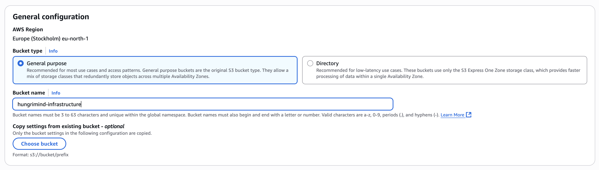
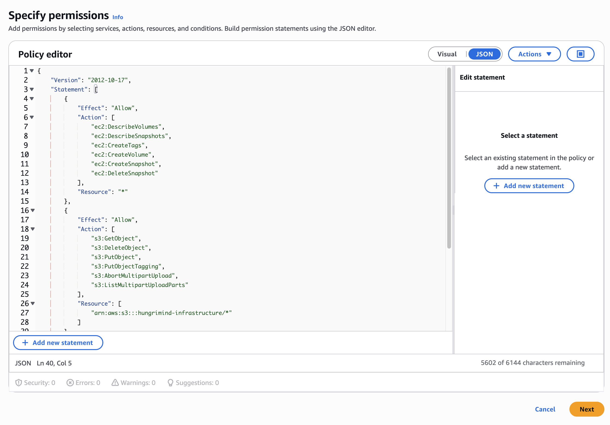
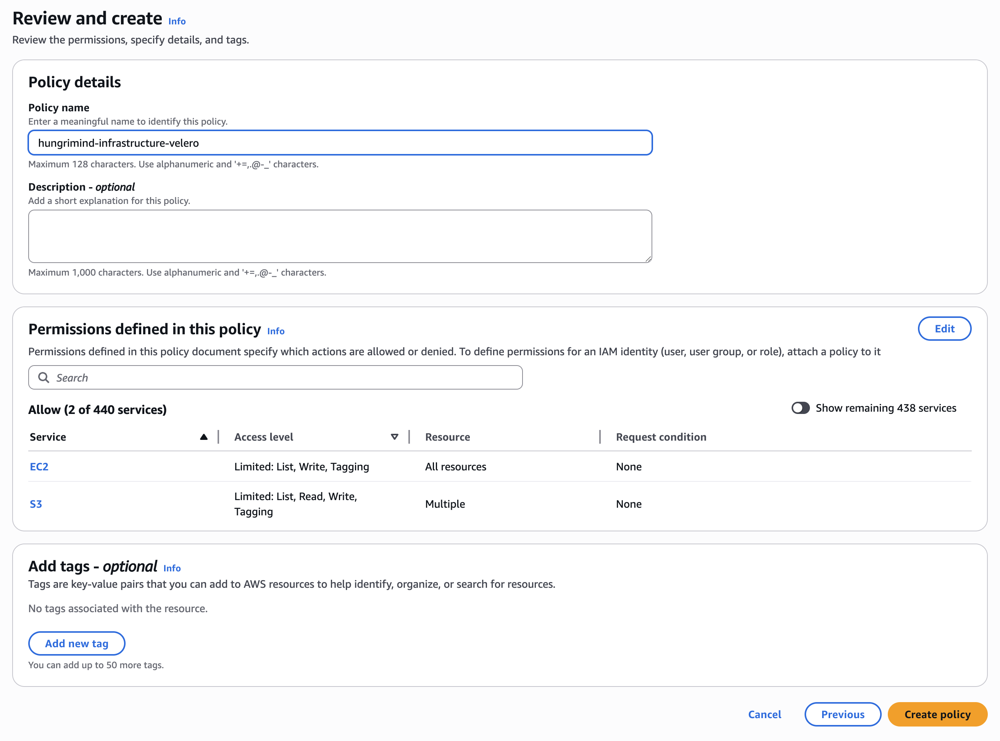
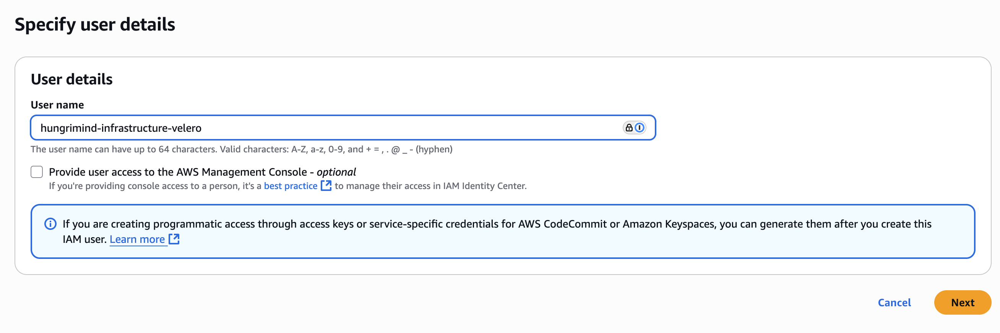
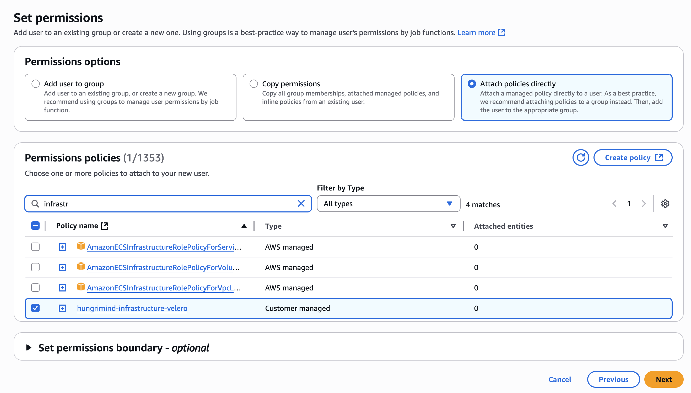
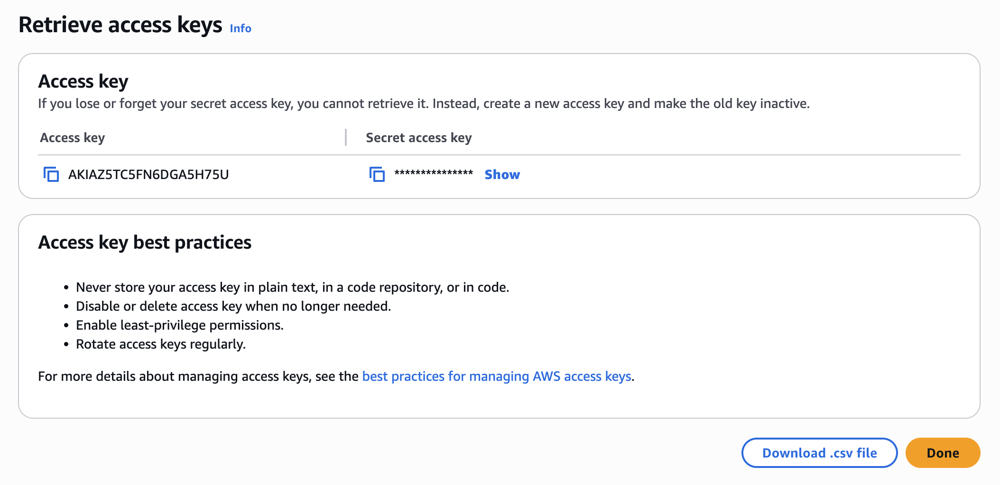
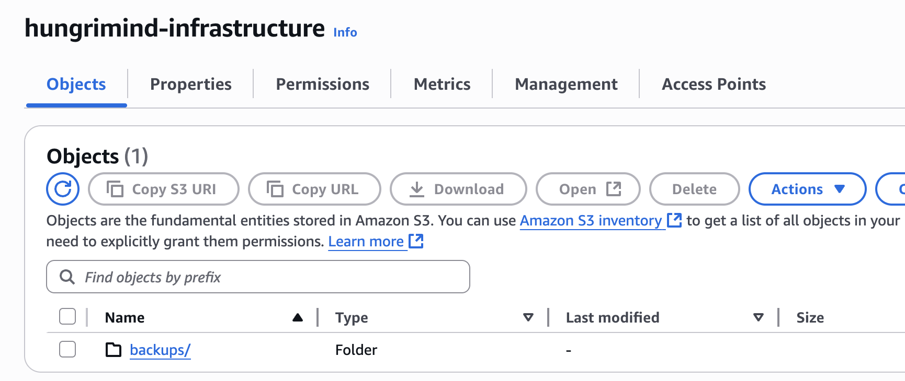

# Backups with Velero

You have a Kubernetes cluster with important data and configurations that need to be backed up regularly. This guide helps you set up Velero with AWS S3 as the storage backend to automatically back up and restore your Kubernetes cluster resources and persistent volumes.

## Background Knowledge

Velero is a powerful open-source tool designed to safely back up and restore, perform disaster recovery, and migrate Kubernetes cluster resources and persistent volumes. It works by taking snapshots of your cluster state and storing them in external storage like AWS S3, allowing you to restore your cluster to a previous state if needed.

This setup uses AWS S3 as the storage backend, which provides reliable, scalable storage for your backups. You'll need to configure AWS IAM permissions to allow Velero to access your S3 bucket and manage EC2 snapshots for persistent volume backups.

## Prerequisites

Before starting, make sure you have:

- A working Kubernetes cluster
- An AWS account with administrative access
- Basic familiarity with AWS IAM and S3
- Access to create S3 buckets and IAM policies/users

## Steps

### 1. Create an S3 Bucket

Navigate to the AWS S3 console at [https://eu-north-1.console.aws.amazon.com/s3/buckets](https://eu-north-1.console.aws.amazon.com/s3/buckets) and click "Create bucket".

For the general configuration, set your desired AWS Region (like Europe Stockholm eu-north-1), provide a unique bucket name (we'll use `your-infrastructure-backups` for this guide - remember this name as you'll need it later), and select "General purpose" for the bucket type.

Leave other settings as default for now, or configure them according to your needs, then click "Create bucket".



### 2. Create IAM Policy

Go to the IAM console at [https://us-east-1.console.aws.amazon.com/iam/home#/policies](https://us-east-1.console.aws.amazon.com/iam/home#/policies) and click "Create policy".

Select the JSON tab and paste the following policy. Make sure to replace `your-infrastructure-backups` with the actual name of your S3 bucket:

```json
{
  "Version": "2012-10-17",
  "Statement": [
    {
      "Effect": "Allow",
      "Action": [
        "ec2:DescribeVolumes",
        "ec2:DescribeSnapshots",
        "ec2:CreateTags",
        "ec2:CreateVolume",
        "ec2:CreateSnapshot",
        "ec2:DeleteSnapshot"
      ],
      "Resource": "*"
    },
    {
      "Effect": "Allow",
      "Action": [
        "s3:GetObject",
        "s3:DeleteObject",
        "s3:PutObject",
        "s3:AbortMultipartUpload",
        "s3:ListMultipartUploadParts"
      ],
      "Resource": ["arn:aws:s3:::your-infrastructure-backups/*"]
    },
    {
      "Effect": "Allow",
      "Action": ["s3:ListBucket", "s3:GetBucketLocation"],
      "Resource": ["arn:aws:s3:::your-infrastructure-backups"]
    }
  ]
}
```



Click "Next". For the policy details, give your policy a descriptive name (like `velero-backup-policy`) and optionally add a description. Review the permissions and click "Create policy".



### 3. Create an IAM User

Navigate to the IAM users page at [https://us-east-1.console.aws.amazon.com/iam/home#/users](https://us-east-1.console.aws.amazon.com/iam/home#/users) and click "Create user".

Under user details, enter a user name (like `velero-backup-user`). You can leave "Provide user access to the AWS Management Console" unchecked, as this user is for programmatic access. Click "Next".



### 4. Attach Policy to User

On the "Set permissions" page, select "Attach policies directly". Search for and select the policy you created (like `velero-backup-policy`). Click "Next".

Review the user details and permissions, then click "Create user".



### 5. Create Access Key

If you're not already on the user's summary page, navigate to the user. Go to the "Security credentials" tab. Scroll down to "Access keys" and click "Create access key".

For the use case, choose "Application running outside AWS" (or "Command Line Interface (CLI)" if more appropriate for initial testing). Click "Next". You can optionally add a description tag. Then, click "Create access key".



Now you'll see the Access key ID and Secret access key. This is the only time you can view the Secret access key, so copy both and store them securely. You'll need these for configuring Velero and potentially for GitHub Actions secrets. You can also download the CSV file containing these keys. Click "Done".

### 6. Store Credentials Securely

You'll need the Access Key ID and Secret Access Key for setting up automated backups via GitHub Actions.

For GitHub Actions, add these as repository secrets:

- `AWS_ACCESS_KEY_ID`: Your access key ID
- `AWS_SECRET_ACCESS_KEY`: Your secret access key

### 7. Deploy Velero to Your Cluster

Install Velero in your Kubernetes cluster with the AWS configuration by running the Velero Deploy GitHub Action.

## Tips and Notes

Make sure to replace all placeholder values (bucket names, regions, etc.) with your actual configuration.

## Verification

After deploying Velero and configuring it with your S3 bucket:

Check that Velero is running properly:

```sh
kubectl get pods -n velero
```

You have a `Velero Backup & Restore` action that you can use and play around with. By default, when Velero is installed, it will do automatic backups, so this is for manual actions.

Check your S3 bucket (like `your-infrastructure-backups`) for a `backups` folder, which will contain your backup data.


