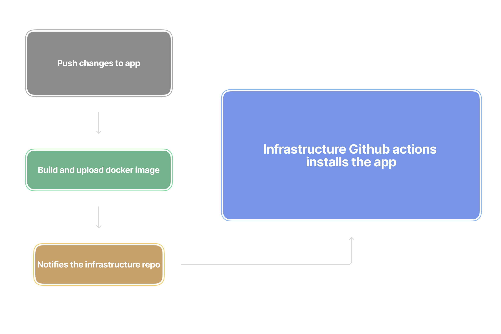

# Deployment with GitHub Actions

You have a Kubernetes cluster and want to automate deployments and other cluster operations directly from your GitHub repository. This guide helps you securely connect GitHub Actions to your Kubernetes cluster so you can deploy applications, manage services, and perform maintenance tasks automatically.

## Background Knowledge

GitHub Actions help automate tasks directly from your repository. For our Kubernetes setup, we use them to manage deployments and other cluster operations, which makes our processes more efficient and consistent.

The connection between GitHub Actions and Kubernetes requires a secure authentication setup using a ServiceAccount, authentication tokens, and GitHub Secrets. This allows GitHub Actions runners to execute kubectl commands against your cluster safely.

## Prerequisites

Before starting, make sure you have:

- A working Kubernetes cluster with kubectl access
- A GitHub repository with Actions enabled
- Administrative access to your Kubernetes cluster
- The `setup_github_actions.sh` script is available in your cluster configuration

## Steps

### 0. Git setup

The first step is to get Git access to your server.

Make sure you are SSH-ed into the server, then generate a new SSH key with the name of id_github

> If you already have a GitHub SSH key in a password manager, this will probably be automatically detected.

```sh
ssh-keygen -t ed25519 -C "hetzner" -f ~/.ssh/id_github
cat ~/.ssh/id_github.pub
```

Add the key in [GitHub](https://github.com/settings/keys)

The last Git step is to make sure we use this key for GitHub-related tasks.

```sh
# edit the SSH config file
nano ~/.ssh/config

# add the following
Host github.com
    HostName github.com
    User git
    IdentityFile ~/.ssh/id_github
    IdentitiesOnly yes
```

Now go to your GitHub account, create a new repo, and push the infrastructure code to it that you have on your server.

### 1. Run the Setup Script

The goal is to minimally interact with the cluster; instead, most interaction will be done through GitHub Actions. We have created some for you, but for them to work, they need access to your Kubernetes Cluster. To do that, we need to set up credentials.

The kit comes with a script to generate these credentials for you by running the following command.

```sh
chmod +x ./setup_github_actions.sh
./setup_github_actions.sh
```

This script creates a dedicated `ServiceAccount` in Kubernetes, generates a long-lived authentication token for this account, and outputs the necessary credentials you'll need.

### 2. Collect Required Credentials

The script will output three important values:

- `KUBE_HOST`: Your Kubernetes API server address
- `KUBE_CERTIFICATE`: The cluster's CA certificate (base64 encoded)
- `KUBE_TOKEN`: The ServiceAccount authentication token

Copy these values securely as you'll need them in the next step.

### 3. Add GitHub Secrets

Navigate to your GitHub repository settings and add the following secrets:

Go to Settings → Secrets and variables → Actions → New repository secret.

Add these three secrets:

- Name: `KUBE_HOST`, Value: [your cluster API server address]
- Name: `KUBE_CERTIFICATE`, Value: [your base64 encoded certificate]
- Name: `KUBE_TOKEN`, Value: [your ServiceAccount token]

### 4. Test the Production Deployment

To test the production deployment, we need to have a new app. [Check the add a new app](add-an-app.md) guide for more information. You can also go to [verification step for deploying Redis](#deploy-redis-with-github-actions) if you just want to try it.

Commit your code and trigger the production deployment manually:

Go to your GitHub repository → Actions → Select your new app workflow → "Run workflow"

> Manual triggers will always deploy the "prod" version of the app you create. While automated deployments (next step) deploy the dev version of the app.

### 5. Automated Development Deployment

The application you created should live in a separate repository. Whenever you make changes to that application, you can trigger a development deployment in the Kubernetes cluster repository by using `repository_dispatch`.



Here is an example of a workflow that will build, upload to Docker Hub, and deploy a Go service to a Kubernetes cluster. The main part of this is the `Trigger Workflow in Cluster` step. This is what will notify the infrastructure repository to deploy the service.

```yaml
name: Build and Deploy Go service

on:
  push:
    branches:
      - "main"
  pull_request:
    branches:
      - "main"
  workflow_dispatch:
    inputs:
      custom_tag:
        description: "Custom image tag (optional)"
        required: false
        type: string
        default: "latest"

env:
  REGISTRY: hungrimind
  IMAGE: IMAGE_NAME
  DISPATCH_REPO: hungrimind/infrastructure
  DISPATCH_EVENT: SERVICE_NAME-build-completed

jobs:
  test:
    runs-on: ubuntu-latest
    steps:
      - uses: actions/checkout@v4

      - name: Set up Go
        uses: actions/setup-go@v4
        with:
          go-version: "1.22"

  build-and-push:
    needs: test
    runs-on: ubuntu-latest
    steps:
      - uses: actions/checkout@v4

      - name: Set version
        id: version
        run: |
          if [ "${{ github.event.inputs.custom_tag }}" != "" ]; then
            echo "VERSION=${{ github.event.inputs.custom_tag }}" >> $GITHUB_OUTPUT
          else
            echo "VERSION=${GITHUB_SHA::7}" >> $GITHUB_OUTPUT
          fi

      - name: Login to Docker Hub
        uses: docker/login-action@v3
        with:
          username: ${{ secrets.DOCKERHUB_USERNAME_HUNGRIMIND }}
          password: ${{ secrets.DOCKERHUB_TOKEN_HUNGRIMIND }}

      - name: Set up Docker Buildx
        uses: docker/setup-buildx-action@v3

      - name: Build and push service
        uses: docker/build-push-action@v5
        with:
          push: true
          tags: |
            ${{ env.REGISTRY }}/${{ env.IMAGE }}:${{ steps.version.outputs.VERSION }}
            ${{ env.REGISTRY }}/${{ env.IMAGE }}:latest

      - name: Trigger Workflow in Cluster
        if: success()
        run: |
          curl -L \
            -X POST \
            -H "Accept: application/vnd.github+json" \
            -H "Authorization: Bearer ${{ secrets.ORG_TOKEN }}" \
            -H "X-GitHub-Api-Version: 2022-11-28" \
            https://api.github.com/repos/${{ env.DISPATCH_REPO }}/dispatches \
            -d '{"event_type":"${{ env.DISPATCH_EVENT }}","client_payload":{"image_tag":"${{ steps.version.outputs.VERSION }}"}}'
```

## Verification

After setting up your GitHub Actions connection:

Test that your workflow can connect to the cluster by making sure the infrastructure and your app repositories have their workflows, then simply make a commit in your app repository to see it build, upload, and notify your cluster to deploy.

```sh
kubectl get pods -n SERVICE_NAME
```

You should see your cluster nodes running.

The Docker images are named after the GitHub commit ID. You should be able to see this in DockerHub.

### Deploy Redis with GitHub Actions

You can test the deployment using our preconfigured Redis app.

1. Navigate to your repository in GitHub.
2. Go to the "Actions" tab.
3. Click on the "Deploy Redis" workflow.
4. Click on "Run workflow".
5. You should see the workflow starting with logs, and once done, you should be able to run the following command to verify within the cluster.

```sh
kubectl get pods -n redis
```
