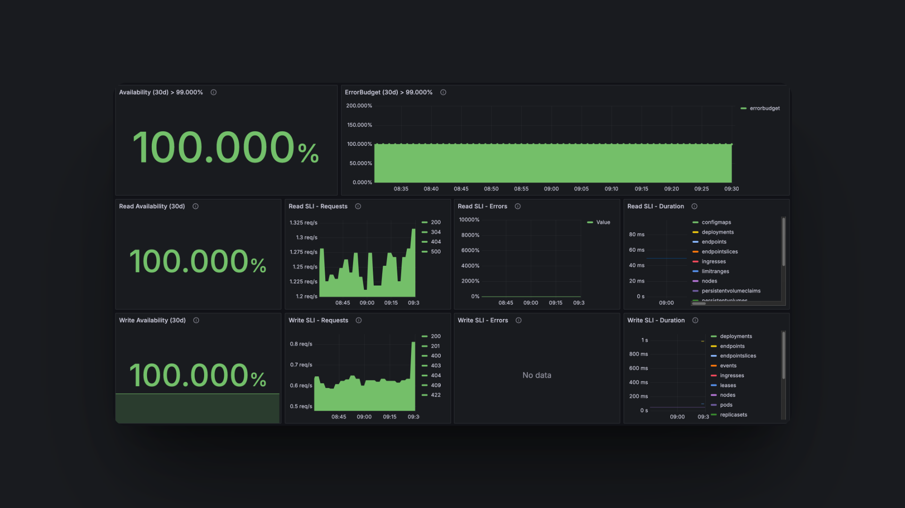

# Deploy Monitoring

Monitoring in our kit includes several components. Grafana for visualization, Prometheus for metrics collection, Loki for log aggregation, and Fluent Bit for log shipping.

When Monitoring is set up, you should have a domain such as monitoring.yourdomain.com. This will show you the Grafana interface, where you can see logs for all your running apps, monitoring of system hardware, and observability of your entire cluster.

## Steps

### 0. Setup

We highly recommend setting this up through GitHub Actions because it involves multiple steps that we already have defined in the pre-configured GitHub workflow, [see GitHub action](deployment.md).

### 1. Domain

When deploying the monitoring stack, you need a domain, username, and password.

Set up a DNS A record for your monitoring setup. The host should be your app name (like Grafana or monitoring), and the value should be your server’s IP address. This will make monitoring.yourdomain.com point to your cluster.

Now that you have a domain, you can do `hungrimind kubernetes configure`, which will let you update values that you haven't updated yet. If you have others than "grafana-host", you can skip those, but make sure to set this to your new domain.

### 2. Credentials

Navigate to GitHub and go to your environment variables. You need to set the following two variables:

- GF_SECURITY_ADMIN_USER
- GF_SECURITY_ADMIN_PASSWORD

### 3. Deploy

Navigate to GitHub and run the `Deploy Monitoring Stack` workflow.

### 4. Explore your analytics

You should now be able to navigate to your domain and get the Grafana dashboard. Here you can monitor the status of the entire cluster, including logs from any app you have deployed.

## Core Concepts

### Prometheus: Metrics Collection and Storage

Prometheus is a leading open-source monitoring system responsible for collecting and storing metrics as time series data. It scrapes metrics from various sources, including Kubernetes nodes (for server statistics), Kubernetes services, and any application-specific endpoints that expose metrics in a Prometheus-compatible format.

These metrics are stored and allow for querying using PromQL (Prometheus Query Language). Prometheus also supports alerting, enabling you to define rules that trigger notifications for potential issues.

### Loki: Efficient Log Aggregation

Loki serves as a highly scalable and available log aggregation system. Inspired by Prometheus, Loki indexes only metadata about your logs (such as labels for application, namespace, etc.) rather than the full log content.

Loki receives logs processed by Fluent Bit and stores them. These logs can then be queried in Grafana using LogQL, a query language similar to PromQL, enabling you to filter and search logs based on their associated labels.

### Fluent Bit: Lightweight Log Shipping

Fluent Bit is a lightweight and extensible log processor and forwarder. Its primary role in this stack is to collect logs from various sources within the Kubernetes cluster and forward them to Loki.

Typically deployed as a DaemonSet (ensuring an instance runs on every node), Fluent Bit tails container log files, processes them as needed, and then ships them to the Loki instance for storage and later analysis.

### Grafana: Unified Visualization Dashboard

Grafana is the user-facing component, providing an open-source platform for querying, visualizing, and understanding your metrics and logs. It connects to Prometheus and Loki as data sources.

Within Grafana, you can create and customize dashboards with various panels to display metrics from Prometheus (like server CPU/memory usage or application request rates) and logs from Loki (such as application errors or request traces). Grafana is exposed externally, as mentioned in the guide, so that you can access it via a web GUI.
